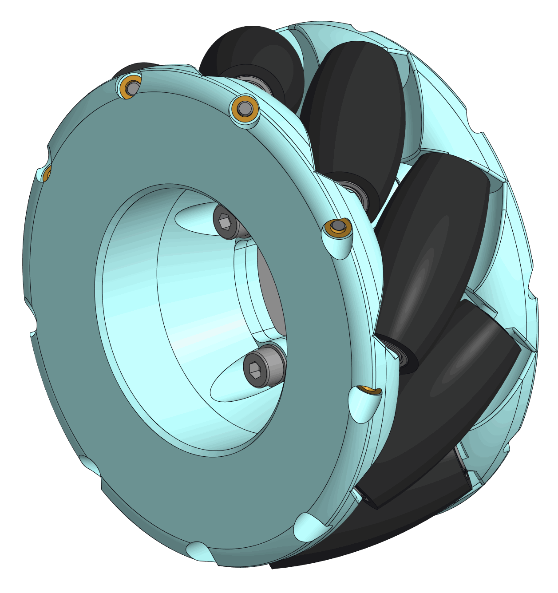
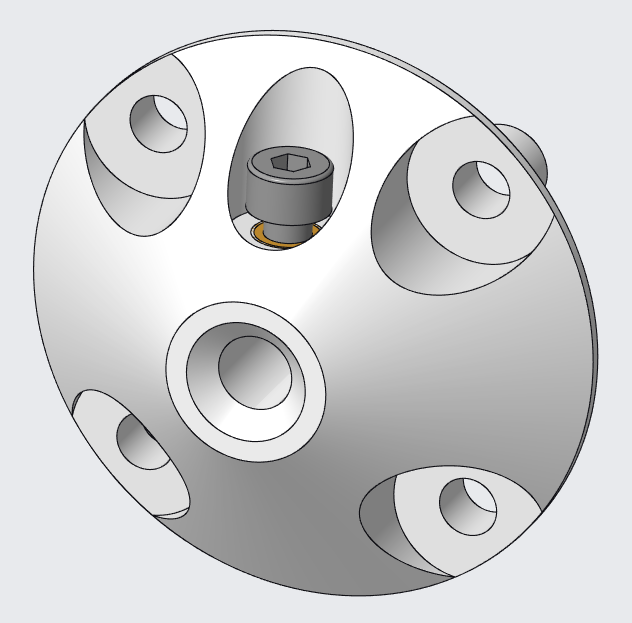

# hw-wheels

Wheels in this repository belong to the [R-MODUS](https://github.com/R-MODUS) project, but they can be reused in other robots as well.

All variants are currently designed for a **Ø 6 mm** motor shaft.

This repo is **mechanical only** — no firmware or ROS.

## Wheels

| Preview | Variant | Summary |
| --- | --- | --- |
|  | [`mecanum-100mm`](wheels/mecanum-100mm/) | Omnidirectional mecanum wheel, Ø 100 mm, 9 rollers |
| — | [`simple-100mm`](wheels/simple-100mm/) | Simple 3D-printed wheel, Ø 100 mm |

## Interfaces

| Preview | Variant | Summary |
| --- | --- | --- |
|  | [`shaft-6mm`](interfaces/shaft-6mm/) | — |

## Licence

[MIT](LICENSE)
